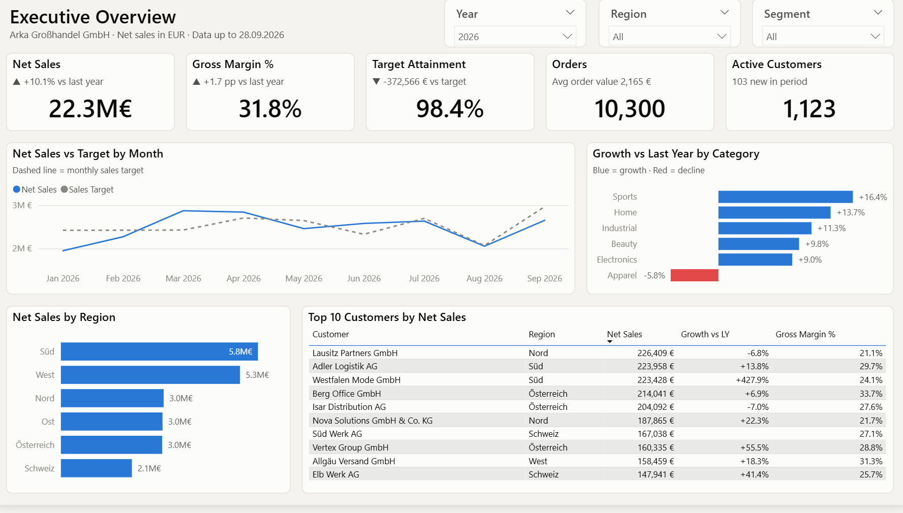
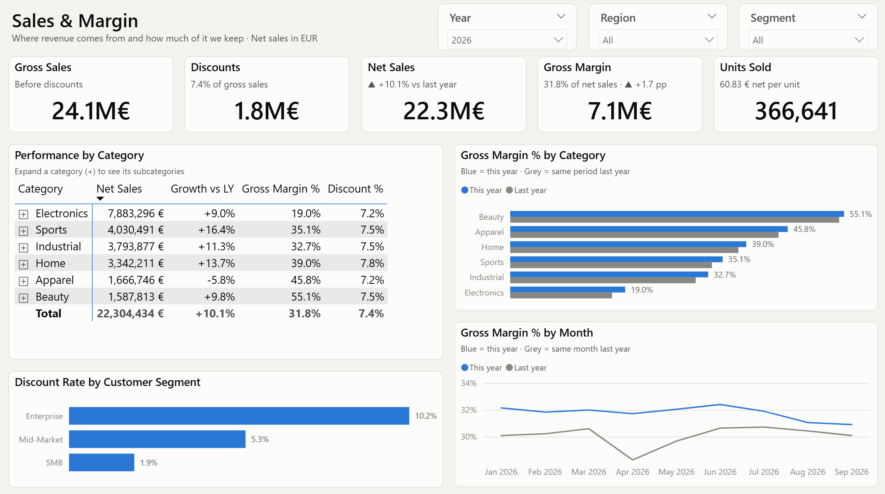
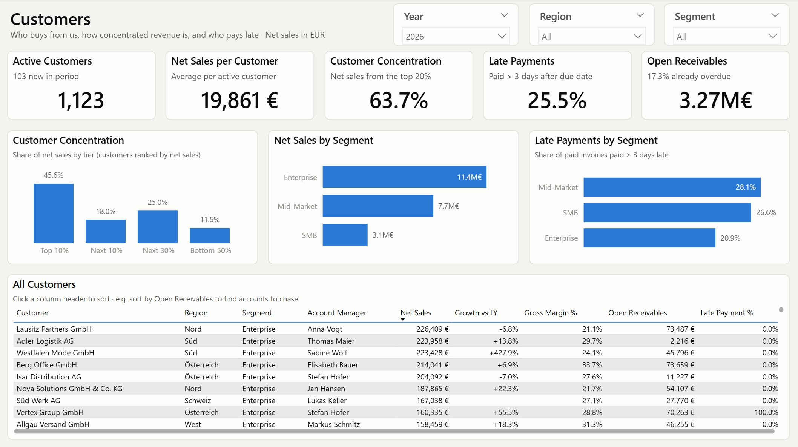
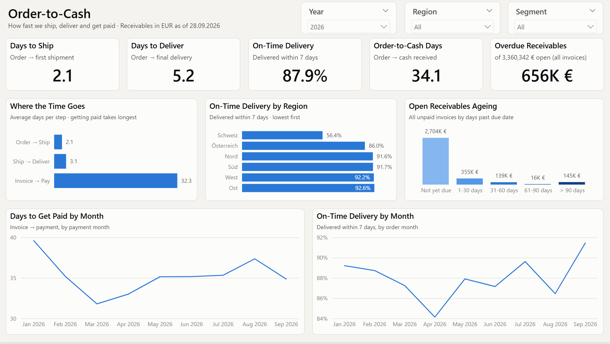
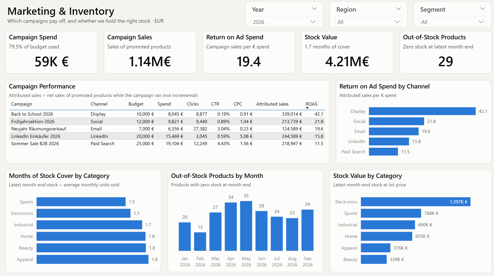
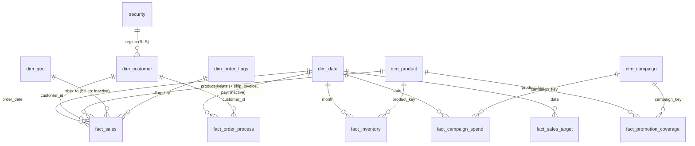

# B2B Sales Analytics – Power BI

Sales, margin, customer and order-to-cash reporting for **Arka Großhandel GmbH**, a fictional
mid-sized B2B wholesaler operating in Germany, Austria and Switzerland (DACH).



**At a glance**

- **5 report pages** for five audiences: management, sales, key accounts, finance and logistics, marketing and purchasing
- **Star schema** with 6 fact tables, 6 dimensions and role-playing dates (4 inactive relationships used with `USERELATIONSHIP`)
- **73 DAX measures** in 9 display folders, every one with a description
- **Row-level security** by sales region
- **GDPR-minded:** customer contact data is removed in Power Query, not just hidden
- **Report as code:** saved as a Power BI Project (PBIP/PBIR + TMDL), so every change is reviewable in Git
- **Accessible design:** colour-blind-safe palette, alt text on every chart, ▲/▼ arrows instead of colour alone

---

## Report pages

All pages share one header layout and the same **Year / Region / Segment** filters, which are synced
across pages. Figures below are for 2026 year-to-date (1 Jan – 28 Sep 2026).

### 1. Executive Overview – *Are we on track?*
Net sales, margin, target attainment, orders and active customers, each compared with last year;
monthly sales against target; growth by category; sales by region; top 10 customers.

> Net sales €22.3M (**+10.1%** vs last year) but **1.6% below target**; apparel is the only declining category.

### 2. Sales & Margin – *Where does revenue come from, and how much do we keep?*
Revenue bridge (gross sales → discounts → net sales → gross margin), category and subcategory matrix,
margin by category vs last year, discount rate by segment, monthly margin trend.

> Electronics is the largest category (€7.9M) with the **lowest margin (19%)**; Enterprise customers receive
> **10.2% discount** vs 1.9% for SMB.



### 3. Customers – *How dependent are we on our biggest customers, and who pays late?*
Customer concentration by tier, sales and late payments by segment, and a sortable list of all customers
with account manager, growth, margin, open receivables and late-payment rate.

> The **top 20% of customers generate 63.7%** of net sales; Mid-Market pays late most often (28%).



### 4. Order-to-Cash – *How fast do we ship, deliver and get paid?*
Days per process step, on-time delivery by region and month, days to get paid by payment month, and an
open-receivables ageing (*Offene-Posten-Liste*) as of the last data date.

> Getting paid takes **32 days** – six times longer than shipping and delivery together. **Switzerland: only
> 56% on time** (customs) vs ~92% in the German regions. €656K of €3.36M open receivables are overdue.



### 5. Marketing & Inventory – *Which campaigns pay off, and do we hold the right stock?*
Campaign table (budget, spend, CTR, CPC, attributed sales, ROAS), return on ad spend by channel, months of
stock cover and stock value by category, out-of-stock products by month.

> Display returns **€42 per € spent** vs €11.5 for Paid Search; out-of-stock products peaked at **35 in May**.



*The data is synthetic (see [About the data](#about-the-data)), so these patterns were designed into the
generator. The report's job is to surface them clearly.*

---

## Data model



| Table | Grain | Purpose |
|---|---|---|
| `fact_sales` | order line | Revenue, cost, quantity, discount |
| `fact_order_process` | order | Order, ship, delivery, invoice and payment dates |
| `fact_inventory` | product × month | Month-end stock (semi-additive) |
| `fact_campaign_spend` | campaign × day | Impressions, clicks, spend |
| `fact_promotion_coverage` | campaign × product | Factless bridge: which products a campaign promotes |
| `fact_sales_target` | month | Sales plan |
| `customer_tier`, `receivable_ageing`, `process_step` | – | Disconnected helper tables for the concentration, ageing and process charts |

All relationships are many-to-one with single-direction filtering.

### Modelling decisions

| Decision | Why |
|---|---|
| **Role-playing dates** on `fact_order_process` (one active, three inactive relationships) | One date table serves every process step; measures switch with `USERELATIONSHIP`, e.g. *days to get paid by payment month* |
| **Like-for-like comparisons**: last-year measures stop at the last data date (28 Sep) | Comparing 9 months of 2026 with 12 months of 2025 would understate growth |
| **Time comparisons only for a single year** (`HASONEVALUE`) | With all years selected, "vs last year" would be meaningless (+147%); cards show *Select one year to compare* instead |
| **Semi-additive stock**: `Stock Units` takes the latest month in context | Stock levels must not be summed over time |
| **Receivables ageing ignores the date filter** | An open-items list always shows everything still unpaid as of today |
| **Split shipments grouped to one row per order** in Power Query | Otherwise orders delivered in two parts are double-counted |
| **Customer contact columns removed** (name, email, phone, street) | GDPR data minimisation (*Datensparsamkeit*): the report never needs them |
| **Auto date/time off, implicit measures discouraged** | One explicit date table; every number in the report comes from a defined measure |
| **One parameter (`RawDataPath`) for the data source** | Whoever clones the repo changes one value instead of 21 queries |

### Measures

| Folder | Measures | Examples |
|---|---:|---|
| 1 Sales | 7 | Net Sales, Discount %, Avg Order Value |
| 2 Profitability | 3 | COGS, Gross Margin, Gross Margin % |
| 3 Targets | 3 | Sales Target, Target Variance, Target Attainment % |
| 4 Time Intelligence | 8 | Net Sales PY, Net Sales YoY %, Net Sales YTD |
| 5 Customers | 7 | Active Customers, New Customers, Top 20% Customer Share |
| 6 Order-to-Cash | 16 | On-Time Delivery %, Late Payment %, Receivables by Ageing |
| 7 Marketing | 9 | Campaign Spend, CTR, CPC, ROAS |
| 8 Inventory | 5 | Stock Units, Months of Cover, Out-of-Stock Products |
| 0 Helpers | 15 | Card subtitles and colour measures |

All measures live in
[`B2B_Sales_Analytics.SemanticModel/definition/tables/_measures.tmdl`](B2B_Sales_Analytics.SemanticModel/definition/tables/_measures.tmdl).

### Row-level security

The role **Regional Access** limits every page to the viewer's sales region:

```dax
[region] = LOOKUPVALUE ( security[region], security[email], USERPRINCIPALNAME () )
```

To test it in Power BI Desktop: **Home → View as → Other user** `katharina.huber@arka.example`,
tick **Regional Access**. Every page now shows only the Süd region.

---

## Repository structure

```
B2B_Sales_Analytics.pbix              single-file version: download and open
B2B_Sales_Analytics.pbip              Power BI Project: open this to work on the report
B2B_Sales_Analytics.SemanticModel/    data model as TMDL (tables, measures, relationships, RLS, Power Query)
B2B_Sales_Analytics.Report/           report as PBIR JSON (one file per page and visual)
data/raw_tables.xlsx                  synthetic ERP export (23 sheets)
generator/generate_data.py            data generator
theme/arka-theme.json                 report theme
tools/                                page builder scripts and PBIR schema validator
screenshots/                          page screenshots used in this README
```

## How to open

**Quick look:** download `B2B_Sales_Analytics.pbix` and open it in Power BI Desktop. The data is
already included.

**Work on the project:**
1. Clone the repository and open `B2B_Sales_Analytics.pbip` in Power BI Desktop (2025 or later).
2. **Transform data → Manage parameters → `RawDataPath`**: set it to the full path of
   `data/raw_tables.xlsx` on your machine.
3. **Home → Refresh.**

## Report as code

The report pages are generated from Python scripts in [`tools/`](tools/), one per page
(`build_executive_overview.py`, `build_sales_margin.py`, …), using shared helpers in `tools/pbir.py`
for the header, synced slicers and KPI cards. This keeps all pages consistent and makes layout changes
reviewable.

```bash
# close Power BI Desktop first, then from the repo root:
python tools/build_executive_overview.py
pip install jsonschema
python tools/validate_pbir.py $(find B2B_Sales_Analytics.Report/definition -name "*.json")
```

The validator checks every report file against the JSON schema Microsoft publishes for it.

---

## About the data

All data is synthetic, generated with [`generator/generate_data.py`](generator/generate_data.py)
(reproducible with seed 2026).

**Why synthetic?** Real B2B sales data (customer contacts, credit limits, payment
behaviour) is personal and commercially sensitive data under GDPR and is never
published. A generated dataset lets the full order-to-cash process be modelled
without those constraints.

**How it was built:** the generator reproduces the structure of a typical ERP export
(23 sheets, SAP-style source IDs), including real-world data-quality issues. These are
cleaned in Power Query, not in the generator.

All company names, people, emails and phone numbers are fictional (emails use the
reserved `.example` domain).

### Volume (seed 2026)

| Table | Rows |
|---|---:|
| Customers | 1,200 |
| Products | 396 |
| Orders | 24,061 |
| Order lines | 76,087 |
| Shipments | 24,908 |
| Invoices | 23,967 |
| Payments | 22,585 |

Period: 1 January 2025 – 28 September 2026. Net revenue ≈ €50M (≈ €28M per year).

### Data generation rules

Every pattern in the report comes from an explicit rule below. The rules were chosen
to resemble a typical DACH wholesaler, so the dashboard has realistic signals to find.

**Customers**

| Rule | Assumption |
|---|---|
| Regions | Süd 26%, West 24%, Nord 14%, Ost 12%, Österreich 13%, Schweiz 11% of customers |
| Segments | SMB 48%, Mid-Market 38%, Enterprise 14% |
| Order frequency | Enterprise customers order ~4.5× as often as SMB, Mid-Market ~2.4×, with individual variation |
| Credit limits | SMB €5k–25k, Mid-Market €25k–100k, Enterprise €100k–500k |
| Payment terms | Mostly *Net 30*. Enterprise also *Net 60*. 35% of SMB customers pay upfront (*Prepaid*) |
| Acquisition | 80% of customers exist before 2025. 20% are acquired during the period |
| Churn | 9% of customers stop ordering at some point in the period |
| Product preferences | Each customer favours 1–3 categories (60% of their lines) |

**Orders and pricing**

| Rule | Assumption |
|---|---|
| Order days | Business days only. Saturdays rare, no orders on Sundays or on German national holidays (1 Jan, 1 May, 3 Oct, 24–26 Dec, 31 Dec) |
| Seasonality | November peak (+22%), August summer-holiday dip (−22%), quieter January, July and December |
| Growth | 2026 volume +3% on 2025, list prices +2.5% |
| Category trends (2026 demand) | Industrial +12%, electronics +10%, beauty +5%, sports +2%, home −2%, apparel −12% |
| Lines per order | 1–6 lines. Enterprise orders get 0–3 extra lines |
| Quantities | Cheaper items are bought in larger quantities. Enterprise buys ~1.9× the quantity of SMB, Mid-Market ~1.3× |
| Discounts | SMB 0–5%, Mid-Market 0–10%, Enterprise 5–15%. +5 points on promoted products (max 15%) |
| Line total | `Quantity × UnitPrice × (1 − DiscountPct)`, i.e. net of discount |
| Gross margin | Cost ratio by category: beauty ~45%, apparel ~52%, home ~58%, sports ~60%, industrial ~63%, electronics ~78% of list price |
| Sales channels | Wholesale 34%, Online Store 30%, Retail Partner 18%, Field Sale 18% |
| Priority | 24% of orders are Express |
| Ship-to / bill-to | 75% ship to the customer's own city, 93% are billed there. The rest go to another city in the same region (branches) |
| Product launches | 8% of products launch during the period, so they have no earlier sales |

**Order-to-cash**

| Rule | Assumption |
|---|---|
| Shipping | Express ships same day, Standard in 1–2 business days |
| Backorders | 7% of orders wait 3–8 extra business days for stock. 60% of those ship in two parts (split delivery) |
| Ship mode | Express → *Express*. Orders over €6,000 → *Freight*. Everything else → *Parcel* |
| Transit time | Express 1 day, Parcel 1–3, Freight 2–5 business days. Austria +0–1, Switzerland +1–3 (customs) |
| Invoicing | Invoiced on the ship date. Prepaid orders are invoiced on the order date |
| Payment behaviour | 62% of customers pay on time (−4 to +3 days vs. due date). 10% take the early-payment discount (*Skonto*) and pay within 7–10 days. 20% pay 4–25 days late. 8% pay 20–75 days late |
| Bad debt | ~0.4% of invoices are never paid |
| Open items | Anything not shipped, delivered or paid by 28 Sep 2026 is left open (Processing / Shipped / unpaid) |

**Marketing, targets and inventory**

| Rule | Assumption |
|---|---|
| Campaigns | 13 campaigns across Email, LinkedIn, Paid Search, Display and Social, each promoting 6–12 products from two categories |
| Campaign uplift | While a campaign runs, 10% of order lines go to its promoted products |
| Campaign metrics | Typical B2B click-through rates (Email 2–4.5%, Paid Search 3–6%, LinkedIn 0.4–0.9%, Display 0.1–0.3%) and cost per click (LinkedIn ~€5.50, Paid Search ~€1.60). Weekend spend is lower |
| Sales targets | 2025 plan ≈ actual ±7%. 2026 plan = 2025 actual +8–14% (an ambitious plan, so some months miss it) |
| Inventory | Month-end stock per product with an order-up-to policy: buyers refill to a target of 1–3 months of cover plus expected demand. 12% of monthly reorders are missed (supply gaps), which causes stock-outs (~6% of product-months at zero) |

**Deliberate data-quality issues** (cleaned in Power Query)

| Issue | Where |
|---|---|
| Test customer `9999 TEST ACCOUNT` | `CUST_MASTER` |
| Test product and duplicate product rows without a supplier | `products` |
| Schema drift: the 2025 export has extra `LegacyRef` and `SourceFile` columns | `ORDERS_2025` vs `ORDERS_2026` |
| Timestamps stored as text | `ORDERS_*[OrderDate]` |
| Duplicate order IDs from split deliveries | `shipments` |
| Missing delivery dates for orders still in transit | `shipments` |
| Stray copy of a sheet | `Sheet1` (duplicate of `shipments`) |
| Wide (pivoted) monthly layout | `inventory` |
| Comma-separated list in one cell | `campaign_skus[PromotedSKUs]` |
| Combined `category\|subcategory` text in lower case | `subcategories` |
| Customer attributes spread over five sheets | `CUST_MASTER`, `Address`, `customer_contacts`, `user_details`, `cities` |
| Unused junk column | `ORDERS_*[GiftMessage]` |

### Regenerating the data

```bash
pip install openpyxl
python generator/generate_data.py                  # seed 2026 → data/raw_tables.xlsx
python generator/generate_data.py --seed 7 --orders 30000 --customers 1500
```
